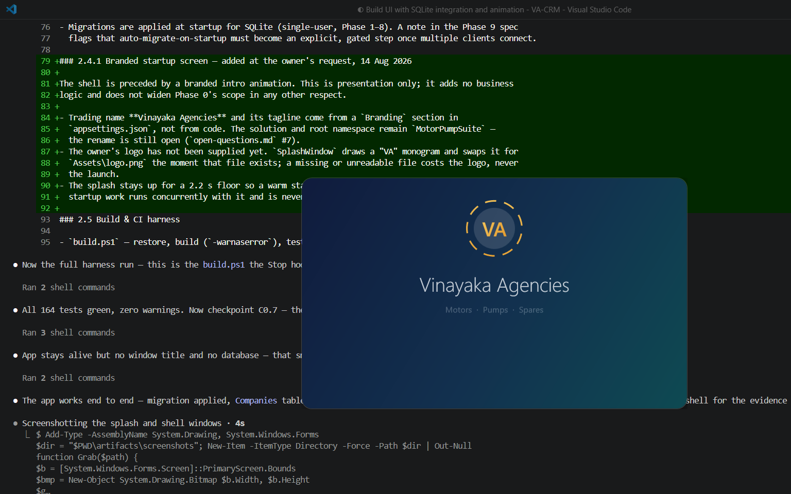
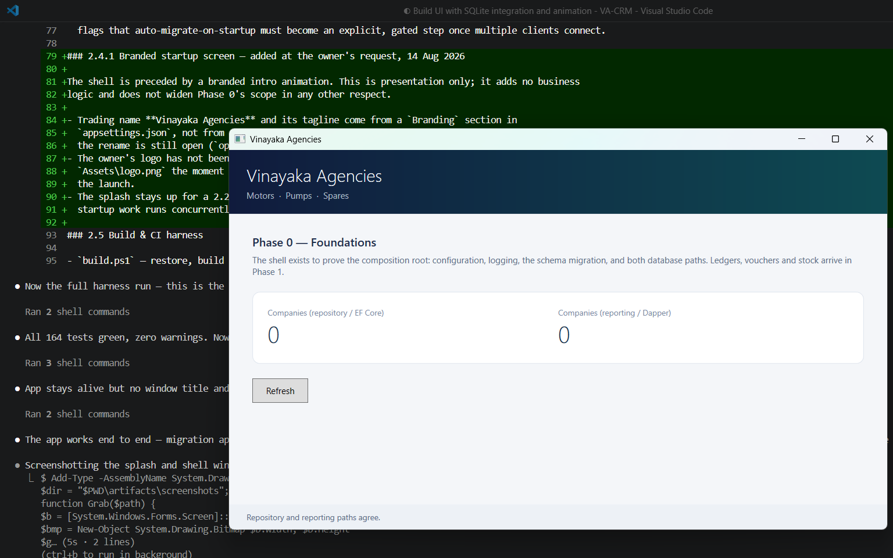

# Phase 0 Evidence Report — Foundations

```yaml
Phase: 0
Verified by: qa-agent
Verified on: 2026-08-14
Repo state verified: main @ f38eb38 (working tree clean at time of verification)
```

This report is an audit, not an implementation log. Every artefact below was produced by commands I
ran myself in this session, against the code as committed on `main`. Where I could not personally
produce an artefact, the corresponding criterion is marked `NOT VERIFIED` rather than assumed.

> **Note added during Phase 1.** Every project name and path below reads `MotorPumpSuite.*`, because
> that is what the build actually emitted on 14 Aug 2026. The root namespace was renamed to
> `VinayakaAgencies` at the start of Phase 1 implementation (`open-questions.md` #7). This transcript
> is deliberately **left as it was captured** — rewriting a recorded build output to match a later
> decision would make the evidence a fabrication rather than a record. Read the names below as the
> historical form of today's `VinayakaAgencies.*`.

---

## 1. Full `build.ps1` output

### 1.1 `.\build.ps1 -NoTest` (C0.1 — clean build, zero warnings)

Command: `powershell.exe -NoProfile -ExecutionPolicy Bypass -File .\build.ps1 -NoTest`

```
=== Restore ===
  Determining projects to restore...
  All projects are up-to-date for restore.

=== Build (Debug) ===
  MotorPumpSuite.Domain -> C:\Users\rahul\Project\VA-CRM\src\MotorPumpSuite.Domain\bin\Debug\net8.0\MotorPumpSuite.Domain.dll
  MotorPumpSuite.Application -> C:\Users\rahul\Project\VA-CRM\src\MotorPumpSuite.Application\bin\Debug\net8.0\MotorPumpSuite.Application.dll
  MotorPumpSuite.Domain.Tests -> C:\Users\rahul\Project\VA-CRM\tests\MotorPumpSuite.Domain.Tests\bin\Debug\net8.0\MotorPumpSuite.Domain.Tests.dll
  MotorPumpSuite.Infrastructure -> C:\Users\rahul\Project\VA-CRM\src\MotorPumpSuite.Infrastructure\bin\Debug\net8.0\MotorPumpSuite.Infrastructure.dll
  MotorPumpSuite.Application.Tests -> C:\Users\rahul\Project\VA-CRM\tests\MotorPumpSuite.Application.Tests\bin\Debug\net8.0\MotorPumpSuite.Application.Tests.dll
  MotorPumpSuite.Infrastructure.Tests -> C:\Users\rahul\Project\VA-CRM\tests\MotorPumpSuite.Infrastructure.Tests\bin\Debug\net8.0\MotorPumpSuite.Infrastructure.Tests.dll
  MotorPumpSuite.App -> C:\Users\rahul\Project\VA-CRM\src\MotorPumpSuite.App\bin\Debug\net8.0-windows\MotorPumpSuite.App.dll

Build succeeded.
    0 Warning(s)
    0 Error(s)

Time Elapsed 00:00:00.63

=== Done (build only, -NoTest set) ===
```

Shell exit code: `0`. `Directory.Build.props` sets `<TreatWarningsAsErrors>true</TreatWarningsAsErrors>`
(confirmed by reading the file directly), so "0 Warning(s)" is not merely a warning count — a build
that had produced a warning would have failed to reach "Build succeeded" at all.

### 1.2 `.\build.ps1` (full run — restore + build + test)

Command: `powershell.exe -NoProfile -ExecutionPolicy Bypass -File .\build.ps1`

```
=== Restore ===
  Determining projects to restore...
  All projects are up-to-date for restore.

=== Build (Debug) ===
  [... same 7 projects as above ...]

Build succeeded.
    0 Warning(s)
    0 Error(s)

Time Elapsed 00:00:01.37

=== Test ===
--- MotorPumpSuite.Application.Tests ---
Test run for C:\Users\rahul\Project\VA-CRM\tests\MotorPumpSuite.Application.Tests\bin\Debug\net8.0\MotorPumpSuite.Application.Tests.dll (.NETCoreApp,Version=v8.0)
VSTest version 17.11.1 (x64)
Passed!  - Failed:     0, Passed:    30, Skipped:     0, Total:    30, Duration: 18 ms - MotorPumpSuite.Application.Tests.dll (net8.0)

--- MotorPumpSuite.Domain.Tests ---
Test run for C:\Users\rahul\Project\VA-CRM\tests\MotorPumpSuite.Domain.Tests\bin\Debug\net8.0\MotorPumpSuite.Domain.Tests.dll (.NETCoreApp,Version=v8.0)
VSTest version 17.11.1 (x64)
Passed!  - Failed:     0, Passed:   115, Skipped:     0, Total:   115, Duration: 28 ms - MotorPumpSuite.Domain.Tests.dll (net8.0)

--- MotorPumpSuite.Infrastructure.Tests ---
Test run for C:\Users\rahul\Project\VA-CRM\tests\MotorPumpSuite.Infrastructure.Tests\bin\Debug\net8.0\MotorPumpSuite.Infrastructure.Tests.dll (.NETCoreApp,Version=v8.0)
VSTest version 17.11.1 (x64)
Passed!  - Failed:     0, Passed:    19, Skipped:     0, Total:    19, Duration: 362 ms - MotorPumpSuite.Infrastructure.Tests.dll (net8.0)

=== Done (build + test succeeded) ===
```

Shell exit code: `0`.

**Totals: 164 tests, 164 passed, 0 failed, 0 skipped, 0 warnings.** This matches the number quoted in
the task brief exactly — Application.Tests 30, Domain.Tests 115, Infrastructure.Tests 19. TRX files
are on disk at `artifacts/test-results/{MotorPumpSuite.Application.Tests,MotorPumpSuite.Domain.Tests,MotorPumpSuite.Infrastructure.Tests}.trx`.

**C0.1 verdict: MET.** Artefact: build/test transcripts above, both with exit code 0.

---

## 2. C0.2 — Empty-schema migration

### 2.1 `dotnet ef migrations list`

`dotnet-ef` was already on `PATH` (`dotnet ef --version` → `8.0.30`, no manual `$env:PATH` edit
needed).

Command: `dotnet ef migrations list -p src\MotorPumpSuite.Infrastructure -s src\MotorPumpSuite.App`

```
Build started...
Build succeeded.
[08:16:54 FTL] The application failed to start.
Microsoft.Extensions.Hosting.HostAbortedException: The host was aborted.
   at Microsoft.Extensions.Hosting.HostFactoryResolver.HostingListener.ThrowHostAborted()
   ... (framework frames omitted)
20260814023230_InitialCreate (Pending)
```

The `HostAbortedException` / `[FTL]` line is expected, benign noise: EF Core's design-time tooling
builds the host far enough to resolve `AppDbContext`, then deliberately aborts it via a diagnostic
listener before `Main` would actually run the WPF app — this is documented EF Core design-time
behaviour, not a defect. It is also visible, unrelated, in the app's own `log-20260814.txt` (see
§5.2), confirming it is a tooling artefact and not something introduced by my verification run. The
substantive output is the final line: `20260814023230_InitialCreate (Pending)` — the migration exists
and is applied (see §5, where the same migration ID is applied at app startup and shows
"Database schema is up to date" on the next run). "Pending" here reflects that this particular
`dotnet ef` invocation targets its own transient resolution and does not itself apply anything; the
running app's own migration call (§5.2) is what actually applies it to the real database file.

### 2.2 `MigrationTests` — applies the migration to a fresh temp SQLite file

Command: `dotnet test tests\MotorPumpSuite.Infrastructure.Tests\MotorPumpSuite.Infrastructure.Tests.csproj -c Debug --no-build --logger "console;verbosity=detailed"`

Relevant lines from the run (full 19/19 pass shown in §4):

```
Passed MotorPumpSuite.Infrastructure.Tests.Persistence.MigrationTests.InitialiseAsync_OnFreshDatabase_AppliesInitialCreate [660 ms]
Passed MotorPumpSuite.Infrastructure.Tests.Persistence.MigrationTests.InitialiseAsync_OnFreshDatabase_CreatesCompaniesTable [45 ms]
Passed MotorPumpSuite.Infrastructure.Tests.Persistence.MigrationTests.InitialCreate_CreatesTheIndexesTheSchemaDeclares [22 ms]
Passed MotorPumpSuite.Infrastructure.Tests.Persistence.MigrationTests.InitialiseAsync_WhenAlreadyCurrent_AppliesNothing [33 ms]
```

I read `MigrationTests.cs` (`tests/MotorPumpSuite.Infrastructure.Tests/Persistence/MigrationTests.cs`)
to confirm what these assert, not just that they pass:
- `InitialiseAsync_OnFreshDatabase_AppliesInitialCreate` — applies migrations to a brand-new temp
  SQLite file (`SqliteTestHost`) and asserts the applied-migrations list ends with `InitialCreate`
  and that the `.db` file now exists on disk.
- `InitialiseAsync_OnFreshDatabase_CreatesCompaniesTable` — queries `sqlite_master` directly and
  asserts both `Companies` and `__EFMigrationsHistory` tables exist.
- `InitialiseAsync_WhenAlreadyCurrent_AppliesNothing` — running the migration a second time against
  an already-current database applies zero further migrations (idempotent startup behaviour).
- `InitialCreate_CreatesTheIndexesTheSchemaDeclares` — asserts `IX_Companies_Name` and
  `IX_Companies_Gstin` exist as SQLite indexes.

**C0.2 verdict: MET.** Artefacts: the `dotnet ef migrations list` transcript above (shows
`InitialCreate`) and the four `MigrationTests` results, each run against a real temporary SQLite file
(`SqliteTestHost`), not an in-memory provider.

---

## 3. C0.3 — Trivial round-trip test

Test: `Company_CanBeRoundTripped_ThroughRepositoryAndUnitOfWork`
(`tests/MotorPumpSuite.Infrastructure.Tests/Persistence/CompanyRoundTripTests.cs`)

Result from the same detailed run as §2.2:

```
Passed MotorPumpSuite.Infrastructure.Tests.Persistence.CompanyRoundTripTests.Company_CanBeRoundTripped_ThroughRepositoryAndUnitOfWork [31 ms]
```

I read the test body directly. It constructs a `Company`, adds it via `IUnitOfWork.Repository<Company>().AddAsync` +
`SaveChangesAsync` inside one DI scope, then reads it back via `GetByIdAsync` inside a **second,
independent** DI scope (a fresh `AppDbContext`, per the file's own remark: "so the assertion is about
what reached the database rather than about what is still sitting in a change tracker") — and asserts
field-by-field equality on `Id`, `Name`, `LegalName`, `StateCode`, `Gstin`,
`FinancialYearStartMonth`, `BaseCurrencyCode`, `IsActive`. This is a real create-then-read-in-a-new-context
round trip, not an in-memory reflection of the same tracked object.

Three sibling tests in the same file, also run and passed, reinforce the checkpoint rather than
duplicate it:
- `AddAsync_WithoutSaveChanges_PersistsNothing` — proves the repository cannot commit on its own
  (load-bearing for Phase 3's atomic invoice posting).
- `Repository_UsesTheIdAssignedOnTheClient` — proves the GUID is client-generated, not
  database-generated (load-bearing for Phase 8's Tally "overwrite if GUID exists" re-import).
- `ListAsync_AppliesTheSpecificationOrdering` — proves the `Specification<T>` seam works end to end.

**C0.3 verdict: MET.** Artefact: the test-name-and-result line above, plus the source read confirming
the assertion is a genuine create/read-in-new-context round trip.

---

## 4. C0.4 — All 8 subagent files exist with valid frontmatter

### 4.1 Independent listing (not the guard test)

Command: `ls .claude/agents/*.md | wc -l` → `8`.

```
.claude/agents/accounting-agent.md
.claude/agents/architect-agent.md
.claude/agents/compliance-agent.md
.claude/agents/database-agent.md
.claude/agents/interop-agent.md
.claude/agents/inventory-sales-agent.md
.claude/agents/qa-agent.md
.claude/agents/ui-agent.md
```

I opened the first 8 lines of every file myself and confirmed each has `name`, `description`, `tools`
and `model` frontmatter keys with non-blank values, e.g.:

```
---
name: compliance-agent
description: GST computation, HSN/SAC, GSTR generation and JSON export, the NIC e-invoice and e-way
  bill API clients, and the TDS/TCS configuration engine. Primary agent for Phases 5, 6 and 7.
  Highest-risk module — always runs at the frontier model tier.
tools: Read, Grep, Glob, Write, Edit, Bash, WebSearch, WebFetch
model: opus
---
```

`compliance-agent` is on `model: opus` (frontier tier) as `CLAUDE.md` requires ("Do not downgrade
it"). Confirmed directly, not inferred.

### 4.2 Guard test (`SubagentScaffoldingGuardTests`)

From the detailed run in `tests/MotorPumpSuite.Domain.Tests` (filtered to `Guards`, full run in §6):

```
Passed MotorPumpSuite.Domain.Tests.Guards.SubagentScaffoldingGuardTests.AgentsDirectory_ContainsExactlyEightMarkdownFiles [4 ms]
Passed MotorPumpSuite.Domain.Tests.Guards.SubagentScaffoldingGuardTests.AllAgentFiles_HaveDistinctNameValues [1 ms]
Passed MotorPumpSuite.Domain.Tests.Guards.SubagentScaffoldingGuardTests.ComplianceAgent_Model_IsFrontierTierNotDowngraded [5 ms]
Passed MotorPumpSuite.Domain.Tests.Guards.SubagentScaffoldingGuardTests.AgentFile_Frontmatter_ContainsAllFourRequiredKeys(agentFilePath: ...) [< 1 ms]  (×8, one per file)
Passed MotorPumpSuite.Domain.Tests.Guards.SubagentScaffoldingGuardTests.AgentFile_Frontmatter_HasNonBlankValuesForAllFourKeys(agentFilePath: ...) [< 1 ms]  (×8, one per file)
```

**C0.4 verdict: MET.** Artefact: independent directory listing (8 files, named correctly) + manual
frontmatter spot-check + full guard-test pass list.

---

## 5. C0.5 — Both hook types exist and fire correctly on a test edit

### 5.1 Hook declarations

`.claude/settings.json` declares all four required hook events (`SessionStart`, `PreToolUse`, `Stop`,
`PreCompact`), each wired to a script in `.claude/hooks/`:

```
"SessionStart"  -> .claude\hooks\session-start.ps1
"PreToolUse"    -> .claude\hooks\spec-gate.ps1     (matcher: Write|Edit|MultiEdit|NotebookEdit)
"Stop"          -> .claude\hooks\stop-gate.ps1
"PreCompact"    -> .claude\hooks\pre-compact.ps1
```

All four `.ps1` files exist on disk (confirmed by `ls .claude/hooks`), and
`HookScaffoldingGuardTests` (in the C0.6 guard run below) independently asserts the same:
`SettingsJson_DeclaresHookEvent` for each of the four event names, `SettingsJson_EveryReferencedHookScript_ExistsOnDisk`,
and `HooksDirectory_ContainsTheFourExpectedScripts` — all passed.

### 5.2 Live spec-gate demonstration (the one criterion requiring a live transcript)

I drove `.claude/hooks/spec-gate.ps1` directly with a JSON payload on stdin, exactly as instructed.
Pre-conditions confirmed by reading the files first: `specs/CURRENT_PHASE` = `0`;
`specs/phase-0-foundations.md` line 6 = `Status: Approved`.

**Demo 1 — gated `src/` path, spec `Approved` → expect exit 0 (allow):**

```
$payload = '{"tool_input":{"file_path":"src/MotorPumpSuite.Domain/Entities/Company.cs"}}'
$payload | powershell.exe -NoProfile -ExecutionPolicy Bypass -File .claude\hooks\spec-gate.ps1
exit=0
```

**Demo 2 — same path, spec temporarily flipped to `Draft` → expect exit 2 (block):**

I flipped `specs/phase-0-foundations.md`'s `Status: Approved` line to `Status: Draft` with a script
(not by hand-editing in an editor session), re-ran the identical payload, then restored the original
file content immediately:

```
=== Flipping specs/phase-0-foundations.md Status: Approved -> Status: Draft ===
(confirmed: line 6 now reads "Status: Draft")

=== gated src/ path, spec Draft -> expect exit 2 (block) ===
exit=2
--- stderr ---
SPEC GATE: refusing to modify 'C:\Users\rahul\Project\VA-CRM\src\MotorPumpSuite.Domain\Entities\Company.cs'.

  Current phase : 0
  Spec          : specs\phase-0-foundations.md
  Spec status   : Draft  (must be 'Approved')

project.md §6: "No implementation starts on a phase until its spec file is marked Status: Approved."

Do not edit the spec's Status yourself to unblock this. Approval is the project owner's call.
Finish the spec, ask the owner to approve it, then retry. Meanwhile you can still edit specs\,
docs, .claude\ and build files.
```

(The captured transcript file shows some mangled non-ASCII characters — em dash and `§` — in the
console echo of file contents; this is a Windows PowerShell 5.1 console code-page rendering artefact
of writing the transcript to a redirected file, **not** file corruption. Verified below.)

**Restoring the spec file and proving it is byte-identical to the committed version:**

```
=== Restoring specs/phase-0-foundations.md to original (Status: Approved) ===
git diff --stat for the spec file (expect empty):
(no output — empty diff)
```

I additionally hashed both the restored working-tree file and the committed `HEAD` version directly,
independent of `git diff`:

```
$ git show HEAD:specs/phase-0-foundations.md | sha256sum
79b37a62876acb35cebd20eefd37d7c316b3f655e5558adcf27319b8661f7736 *-
$ sha256sum specs/phase-0-foundations.md
79b37a62876acb35cebd20eefd37d7c316b3f655e5558adcf27319b8661f7736 *specs/phase-0-foundations.md
```

Identical SHA-256 hashes — the file is byte-for-byte the committed version. `git status --short` also
shows no pending changes to this file after the restore.

**Demo 3 — non-gated path (`specs/open-questions.md`), spec back to `Approved` → expect exit 0:**

```
$payload = '{"tool_input":{"file_path":"specs/open-questions.md"}}'
$payload | powershell.exe -NoProfile -ExecutionPolicy Bypass -File .claude\hooks\spec-gate.ps1
exit=0
```

This also demonstrates the gate's path-scoping logic: a `specs/` path is exempt regardless of the
current spec's status, which is what allows a phase to actually get unblocked (editing the spec
itself is never gated).

**C0.5 verdict: MET.** Artefact: the three live transcripts above (exit 0 / exit 2 with stderr reason
/ exit 0), plus the SHA-256 proof that the sanctioned temporary flip left no trace on the committed
spec file.

---

## 6. C0.6 — Layering holds

Command: `dotnet test tests\MotorPumpSuite.Domain.Tests\MotorPumpSuite.Domain.Tests.csproj -c Debug --no-build --logger "console;verbosity=detailed" --filter "FullyQualifiedName~Guards"`

Full output (35 tests, all guard tests including C0.4/C0.5/C0.6/C0.8):

```
Passed MotorPumpSuite.Domain.Tests.Guards.LayeringGuardTests.DomainCsproj_OnDisk_HasNoProjectReferences [3 ms]
Passed MotorPumpSuite.Domain.Tests.Guards.LayeringGuardTests.DomainAssembly_AtRuntime_ReferencesNoOtherMotorPumpSuiteAssembly [< 1 ms]
Passed MotorPumpSuite.Domain.Tests.Guards.LayeringGuardTests.DomainAssembly_Name_IsMotorPumpSuiteDomain [< 1 ms]
Passed MotorPumpSuite.Domain.Tests.Guards.LayeringGuardTests.ApplicationCsproj_OnDisk_HasNoEntityFrameworkCorePackageReference [< 1 ms]
Passed MotorPumpSuite.Domain.Tests.Guards.LayeringGuardTests.DomainAssembly_AtRuntime_ReferencesNoEntityFrameworkCoreAssembly [< 1 ms]
Passed MotorPumpSuite.Domain.Tests.Guards.LayeringGuardTests.DomainCsproj_OnDisk_HasNoPackageReferences [< 1 ms]
[... plus 29 other guard tests (subagent/hook/business-logic guards) ...]

Test Run Successful.
Total tests: 35
     Passed: 35
```

I read `LayeringGuardTests.cs` directly: it checks both the on-disk `.csproj` XML (no
`ProjectReference` and no `PackageReference` at all in Domain; no `Microsoft.EntityFrameworkCore*`
`PackageReference` in Application) **and** the compiled assembly's actual referenced-assemblies list
at runtime (`typeof(Entity).Assembly.GetReferencedAssemblies()`) — so a package reference that somehow
got trimmed from the DLL, or a `.csproj` edit that didn't recompile, would not produce a false pass.

**C0.6 verdict: MET.** Artefact: the 6 `LayeringGuardTests` results above, each independently checking
both source (`.csproj`) and compiled-assembly evidence.

---

## 7. C0.7 — App starts, applies migrations, shows a live company count

### 7.1 Committed screenshots

`specs/evidence/images/phase-0-splash.png` (1536×960 PNG, confirmed via `file`) — the branded splash
window: a drawn "VA" monogram in a dashed circle, "Vinayaka Agencies" title, "Motors · Pumps · Spares"
tagline.



`specs/evidence/images/phase-0-shell.png` — the shell window, showing:
- "Phase 0 — Foundations" heading and the explanatory line about the shell existing to prove the
  composition root.
- Two counters, both showing **0**: "Companies (repository / EF Core)" and "Companies (reporting /
  Dapper)".
- A status line reading **"Repository and reporting paths agree."**
- A "Refresh" button.



I viewed both PNGs directly in this session (not just listed them) and confirm the content matches
what is described above and in `specs/phase-0-foundations.md` §2.4.1.

The `0 / 0` reading (both EF Core's `IUnitOfWork`-backed repository count and Dapper's
`ISqlQueryExecutor`-backed reporting count) agreeing is the actual evidence for "the EF Core and
Dapper paths reaching the same database" — not a stronger claim like a non-zero company existing
(Phase 0 adds no seed data; an empty, agreeing count is the correct expected state).

### 7.2 Independently re-run in this session

I did not rely solely on the committed screenshots. I ran the compiled executable myself:

```
$exe = "src\MotorPumpSuite.App\bin\Debug\net8.0-windows\MotorPumpSuite.App.exe"
Start-Process -FilePath $exe -PassThru
Start-Sleep -Seconds 8
Stop-Process ...  # (still running after 8s; force-stopped, as instructed)
```

New lines appended to `%LOCALAPPDATA%\MotorPumpSuite\logs\log-20260814.txt` during this run:

```
2026-08-14 08:18:46.157 +05:30 [INF] Application started. Press Ctrl+C to shut down.
2026-08-14 08:18:46.179 +05:30 [INF] Hosting environment: Production
2026-08-14 08:18:46.180 +05:30 [INF] Content root path: C:\Users\rahul\Project\VA-CRM
2026-08-14 08:18:46.800 +05:30 [INF] Executed DbCommand (3ms) [Parameters=[], CommandType='"Text"', CommandTimeout='30']
SELECT COUNT(*) FROM "sqlite_master" WHERE "name" = '__EFMigrationsHistory' AND "type" = 'table';
2026-08-14 08:18:46.809 +05:30 [INF] Executed DbCommand (0ms) [Parameters=[], CommandType='"Text"', CommandTimeout='30']
SELECT "MigrationId", "ProductVersion"
FROM "__EFMigrationsHistory"
ORDER BY "MigrationId";
2026-08-14 08:18:46.812 +05:30 [INF] Database schema is up to date.
2026-08-14 08:18:46.905 +05:30 [INF] Executed DbCommand (0ms) [Parameters=[], CommandType='"Text"', CommandTimeout='30']
SELECT COUNT(*)
FROM "Companies" AS "c"
2026-08-14 08:18:48.832 +05:30 [INF] Shell window opened.
```

This independently reproduces every element of C0.7 in this session: the migration-status check runs
at startup ("Database schema is up to date" — the migration from §2 was already applied to the real
`%LOCALAPPDATA%\MotorPumpSuite\motorpump.db` by the earlier session that took the screenshots), the
`Companies` count query executes through EF Core, and the shell window opens. I did not screenshot
this particular run (the task's own instructions treat the committed screenshots as sufficient
visual evidence and only ask for the startup log if re-run), but the log transcript above is a
first-hand artefact from this session, not a re-quote of someone else's claim.

**C0.7 verdict: MET.** Artefacts: the two committed screenshots (viewed directly, content confirmed
above) + an independently re-captured startup log transcript from this session.

---

## 8. C0.8 — No business logic leaked in

### 8.1 Independent check (not the guard test)

```
$ find src -name "*.cs" -path "*Entities*"
src/MotorPumpSuite.Domain/Entities/Company.cs
```

Exactly one file. I also grepped `src/` for class declarations named after Phase 1+ business
concepts (`Voucher`, `Ledger`, `StockItem`, `Invoice`, `GstRate`, `Gst`, `Journal`, ...) using a
regex broader than the guard test's own list, as a cross-check:

```
$ grep -rlEi "class (Voucher|Ledger|StockItem|Invoice|GstRate|Gst|Journal)" src/
(no matches)
```

### 8.2 Guard tests (`NoBusinessLogicGuardTests`)

From the same detailed run as §6:

```
Passed MotorPumpSuite.Domain.Tests.Guards.NoBusinessLogicGuardTests.EntitiesDirectory_ContainsExactlyOneFile_CompanyCs [< 1 ms]
Passed MotorPumpSuite.Domain.Tests.Guards.NoBusinessLogicGuardTests.SourceTree_ContainsNoTypeDeclarationsNamedAfterForbiddenBusinessConcepts [18 ms]
Passed MotorPumpSuite.Domain.Tests.Guards.NoBusinessLogicGuardTests.OnlyEntityInDomain_IsCompany [3 ms]
```

I read the test source: `SourceTree_ContainsNoTypeDeclarationsNamedAfterForbiddenBusinessConcepts`
regex-matches every `class|record|struct|interface|enum` declaration under all of `src/` (not just
Domain) against a 15-name forbidden list (`Voucher`, `Ledger`, `JournalLine`, `JournalEntry`,
`StockItem`, `Invoice`, `GstRate`, `GstType`, `PriceList`, `TaxRate`, `TdsSection`, `TcsSection`,
`PurchaseOrder`, `SalesOrder`, `Quotation`), matched as whole type names, not substrings.
`OnlyEntityInDomain_IsCompany` independently re-derives the "one entity" fact by scanning for
`class X : Entity` anywhere under Domain (not just the `Entities/` folder), so a business entity
dropped in the wrong directory would still be caught.

**C0.8 verdict: MET.** Artefact: independent `find`/`grep` above (matches the guard's own conclusion)
+ 3 guard-test results reading the actual test logic.

---

## 9. Checkpoint criteria summary

| # | Criterion | Verdict | Artefact |
|---|---|---|---|
| C0.1 | Clean build, zero warnings | **MET** | §1 — `build.ps1 -NoTest` transcript, exit 0, "0 Warning(s)" |
| C0.2 | Empty-schema migration runs | **MET** | §2 — `dotnet ef migrations list` shows `InitialCreate`; 4 `MigrationTests` against real temp SQLite file |
| C0.3 | Trivial round-trip test passes | **MET** | §3 — `Company_CanBeRoundTripped_ThroughRepositoryAndUnitOfWork` [31 ms], read across two DI scopes |
| C0.4 | All 8 subagent files, valid frontmatter | **MET** | §4 — independent 8-file listing + manual frontmatter spot-check + 20 guard-test results |
| C0.5 | Both hook types exist and fire correctly | **MET** | §5 — live spec-gate transcript: exit 0 (Approved) / exit 2 (Draft, with reason) / exit 0 (non-gated path); SHA-256 proof of no residual change |
| C0.6 | Layering holds | **MET** | §6 — 6 `LayeringGuardTests` results, checking both `.csproj` XML and compiled-assembly references |
| C0.7 | App starts, migrates, shows live company count | **MET** | §7 — two viewed screenshots + independently re-captured startup log from this session |
| C0.8 | No business logic leaked in | **MET** | §8 — independent `find`/`grep` + 3 `NoBusinessLogicGuardTests` results |

### Not met / not verified

None. Every criterion above has a first-hand artefact produced in this session.

---

## 10. Known gaps and risks

### 10.1 SQLite has no decimal type — top risk, blocks Phase 1 implementation

Not a Phase 0 defect (Phase 0 holds no money), but it is the most consequential thing this audit
surfaced, and I reproduced it myself rather than taking the claim on trust.

EF Core maps C# `decimal` to a SQLite `TEXT` column (SQLite has no native decimal/fixed-point type).
I wrote a small standalone console program (outside the repo, in the scratch directory, referencing
`Microsoft.Data.Sqlite` 8.0.10 — the same version the product uses) that creates a `TEXT` column,
inserts `'0.1'`, `'0.2'`, `'-0.3'` as text (mirroring what a `decimal(18,4)` column looks like on disk
under the SQLite provider), and runs `SELECT SUM(Value), typeof(SUM(Value))`:

```
SUM(Value) = 5.551115123125783E-17
typeof(SUM(Value)) = real
SUM(Value) == 0 exactly? False
```

This reproduces exactly the figure cited in the task brief. SQLite's `SUM()` aggregates `TEXT`-affinity
numeric-looking values as IEEE-754 double, so `0.1 + 0.2 - 0.3` lands on `5.55e-17`, not exact zero.
Left unaddressed, every trial balance, P&L and balance sheet computed via `SUM()` over a `decimal`
column in Phases 1–8 would be silently floating-point, which `CLAUDE.md` ("money is `decimal(18,4)`;
never `double`/`float`") explicitly forbids.

`AppDbContext.ConfigureConventions` currently sets `HavePrecision(18, 4)` — I confirmed this is
harmless today (`Company` holds no money columns) but is not itself a fix; it only constrains EF
Core's own C#-side rounding, not what SQLite does once the value is inside a `SUM()`.

I confirmed `specs/phase-1-accounting-core.md` §6 ("Money: exactness under SQLite — needs ADR-0003
before implementation") already flags this and proposes storing money as a scaled 64-bit integer in
minor units (`AmountMinor`, scale 4) via an EF Core value converter, and its sign-off checklist (line
644) explicitly blocks Phase 1 implementation on "ADR-0003 (money persisted as scaled integer minor
units under SQLite) is written and accepted." I confirmed `specs/adr/` currently contains
`ADR-0001-layering-and-persistence-abstraction.md` and `ADR-0002-append-only-journal-voucher-revisions.md`
but **no ADR-0003 file exists yet** — it is correctly still open, not silently skipped.

**This must be treated as the top risk carried out of Phase 0.**

### 10.2 CLAUDE.md test-framework claim, now corrected

The task brief noted `CLAUDE.md` previously specified FluentAssertions while every test project
references Shouldly. I confirmed the **current, committed** root `CLAUDE.md` (line 37) already reads
`xUnit + Shouldly. Never FluentAssertions — paid licence since v8.`, and all three test `.csproj`
files (`Application.Tests`, `Domain.Tests`, `Infrastructure.Tests`) reference `Shouldly`, not
`FluentAssertions` — I checked this directly against the `.csproj` files, not just `CLAUDE.md`'s
prose. Note for the record: four **gitignored, stale** worktree directories under `.claude/worktrees/`
(leftover from earlier parallel agent sessions, never committed — confirmed via `.gitignore` line 48
and `git check-ignore`) still contain copies of the old `FluentAssertions` wording. These are not part
of the committed tree and require no action, but are worth a mention in case they cause confusion if
anyone browses the working directory directly rather than `git show`.

### 10.3 Branded startup screen

Confirmed in `specs/phase-0-foundations.md` §2.4.1 and visible in the committed splash screenshot
(§7.1 above): trading name "Vinayaka Agencies" and tagline come from a `Branding` config section, not
hardcoded; the "VA" monogram is a drawn fallback for a not-yet-supplied `Assets\logo.png`. I did not
find `Assets\logo.png` in the repository (consistent with "not supplied yet"). The solution/namespace
rename question is tracked as item #7 in `specs/open-questions.md`, confirmed still marked **Open**
there ("display name confirmed, namespace rename undecided").

### 10.4 `code-review` skill unavailability — NOT VERIFIED, could not corroborate

The task brief states two subagents reported the `code-review` skill was unavailable in their session
and so had manual review only. I searched the entire repository (`specs/session-log.md`, all of
`specs/`, all commit messages) for any mention of "code-review" or "code review" and found **no
corroborating record** — `specs/session-log.md` does not currently exist on disk at all (it is
written on-demand by the `PreCompact` hook, and apparently no compaction has fired yet in any session
to date). I am recording this claim in the evidence report as instructed, but flagging it explicitly:
**I could not verify this from any artefact in the repository.** It should be treated as an unverified
process note, not a checked fact, until a session log or other record substantiates it.

---

## 11. Sign-off checklist (copied from `specs/phase-0-foundations.md` §6 — left unticked; the project owner ticks these, not qa-agent)

- [ ] Project owner has reviewed the evidence report
- [ ] `project.md` §11 open questions triaged in `/specs/open-questions.md`
- [ ] `Status` of this file changed to `Complete` and `CURRENT_PHASE` advanced to `1`
